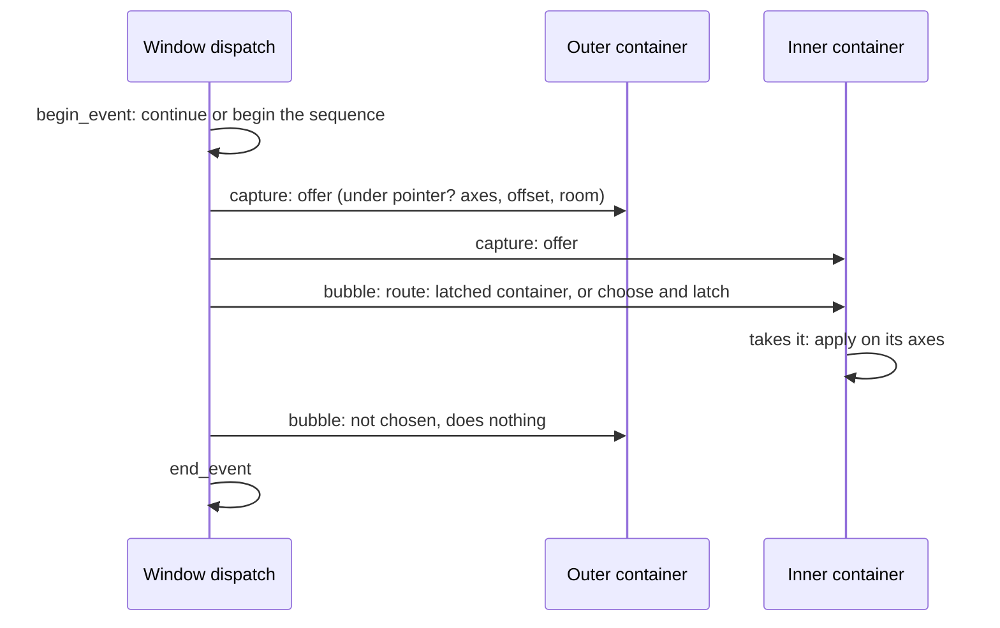

# Scrolling: which container a wheel moves

A wheel tick or a trackpad swipe moves **one** scroll container, chosen the
way Chrome and Safari on macOS choose it, and that container keeps the whole
gesture. This holds for every scroll container: a `div` with
`overflow_*_scroll`, a `uniform_list` and a `list`, nested in any order.
The code is `crates/gpui/src/fast/scroll_chain.rs`.

## The rules

| Rule | What happens |
|---|---|
| **Axis** | A container moves only along the axes it scrolls. A vertical wheel over a box that scrolls only horizontally doesn't move it; the box around it that scrolls vertically takes the wheel. **Shift+wheel** scrolls horizontally. |
| **Chaining** | The event's dominant axis (vertical on a tie) picks the container: the innermost under the pointer that scrolls on that axis and can still move in that direction. No other container moves for that event, so nothing scrolls diagonally, and a page never scrolls along with the box under the pointer. |
| **Latching** | The container the first event of a *sequence* went to takes every event of it, even once it reaches its edge: the scroll doesn't spill into the page mid-gesture. A new sequence that starts at the edge chains to the container around it. |
| **Momentum** | A trackpad's momentum after the fingers lift stays with the container the gesture went to. |

A **sequence** is:

- for a trackpad (events with touch phases): one gesture, from its
  `Started` phase through its `Ended`, and the momentum that begins within
  100 ms of the end;
- for a mouse wheel (no phases): ticks less than **500 ms** apart, the pointer
  within **10 px** of where the first one was, with the same modifiers.

Until a sequence's events move something (a wheel at the very end of
everything under the pointer), each event is routed afresh.

A synthetic scroll the window sends itself, to bring an accessibility node
into view, is a sequence of its own for each container it scrolls.

### Where the rules come from

These are Chromium's, cited in each fixture expectation:

- the sequence, its 500 ms timeout, its 10 px slop, modifiers ending it and
  the 100 ms momentum wait: `content/browser/renderer_host/input/mouse_wheel_phase_handler.{h,cc}`
  (`kDefaultMouseWheelLatchingTransactionTimeout`, `kWheelLatchingSlopRegion`);
- the latched container: `cc/input/input_handler.cc`, `FindNodeToLatch`
  (walk up from the box under the pointer to the first that can consume the
  delta) and `ScrollLatchedScroller` (scroll only it for the rest of the
  sequence);
- an axis without `overflow: auto | scroll` doesn't scroll: CSS Overflow 3.

One difference: Chrome latches the first box that can consume *either* axis
of the delta, and a box that scrolls both ways then takes both. GPUI picks by
the dominant axis, so a mostly vertical swipe with some sideways drift goes to
the box that can move vertically. A box that scrolls both ways moves on both
only with `allow_concurrent_scroll` (below).

## Lists

`list` and `uniform_list` follow the same rules; `uniform_list` is a `div`
scroll container underneath. A `list` knows how far it scrolls only from the
rows it has measured, so rows not yet measured on one side count as room on
that side: a list chains to its parent at an end once it has measured the
rows there. A list still counts a wheel line as 20 px, as before.

## Opt-ins

| Style | Meaning |
|---|---|
| `allow_concurrent_scroll` | A container that scrolls both ways moves along both axes of a diagonal delta, as browsers do. Without it, it moves along the larger axis of each delta only. |
| `restrict_scroll_to_axis` | Within the container a trackpad gesture went to, the gesture stays locked to the axis it began along (released when it turns strongly), so sideways drift in a vertical swipe doesn't move a two-way box sideways. It never sends the other axis to another container. |

No style turns axis remapping on: the old behaviour, where a box that scrolls
only horizontally took a vertical wheel as horizontal movement, is gone.
`overscroll-behavior` has no GPUI counterpart; latching already keeps a
gesture from spilling into the page.

## How it works

Every container's wheel listener takes part in each `ScrollEvent`:



Nothing stops propagation, so other wheel listeners (a scrollbar that shows
itself on a wheel) still hear every event. The scroll state lives in
`WindowLayers::scroll_chain`. A container that takes an event it can't move
(latched at its edge) changes nothing and doesn't rebuild its view
(`fast::layers::wheel::moves`).

## Tests

`crates/gpui/src/fast/tests/scroll_chain/fixture.json` lists the scenarios
(vertical in vertical, horizontal in vertical by wheel and trackpad, vertical
in horizontal, two-way box in vertical, inner box at its edge at the start of
a gesture and mid-gesture, shift+wheel, a box that doesn't overflow, three
levels deep, the latching timeout and slop) with the outcome Chrome gives and
the source each is cited from. `crates/gpui/src/fast/tests/scroll_chain.rs`
runs each as a `#[gpui::test]`: it builds the boxes, finds the one under the
pointer in the accessibility tree, sends the wheel ticks and touch phases, and
checks that exactly the boxes the fixture names moved, and which way. The
same scenarios run with a `list` and a `uniform_list` as the inner box, and
GPUI-only tests cover the opt-ins and a horizontal box inside a list.

```sh
cargo test -p gpui --features test-support,gpui_platform/runtime_shaders --lib fast::tests::scroll_chain
```

`scroll_chain/record.mjs` replays every scenario in Chrome with Playwright
and prints where Chrome differs from the fixture (how to run it is at its
top). It needs a machine that can start Chrome: the sandbox the fixture was
written in can't, so its expectations are cited from Chromium's source rather
than recorded.

## For apps upgrading

A container that scrolls only horizontally no longer moves on a plain mouse
wheel; mouse users scroll it with shift+wheel, trackpad users with a
sideways swipe, as in a browser. The vertical wheel now scrolls the page
around it instead of being taken by the box.
